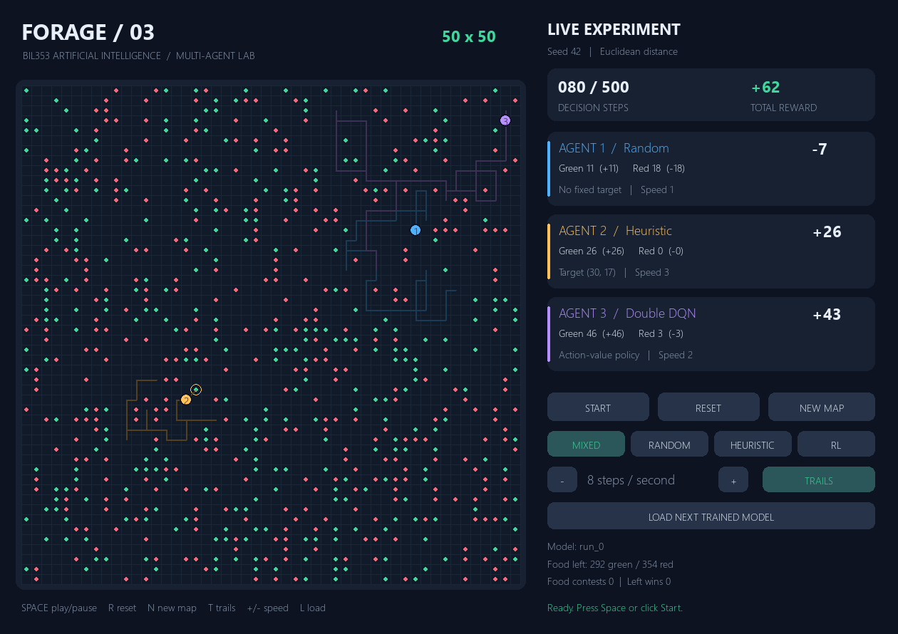

# BIL353 - Multi-Agent Food Foraging

50x50 tahtada üç bağımsız ajan. Random, Heuristic ve NumPy ile Independent Double
DQN; Pygame arayüzü, otomatik testler, gerçek deney verileri ve İngilizce PDF rapor.



[Güncel proje raporu (PDF)](output/pdf/Project_Report_Revised.pdf)

## Hemen çalıştır

Windows'ta Python 3.13 kurulu olmalı. Repoyu indirdikten sonra proje klasöründe
önce **Setup.bat**, ardından **Start_Game.bat** dosyasına çift tıkla.
Paket kurulumu internet gerektirir. Başlatıcı, gerekli paketlerin bulunduğu
proje içi veya üst klasördeki sanal ortamı otomatik seçer.

Git ile indirmek ve PowerShell üzerinden kurmak için:

```powershell
git clone https://github.com/omerfarukocak2/multi-agent-food-foraging.git
cd multi-agent-food-foraging
python -m venv .venv
.\.venv\Scripts\python.exe -m pip install -r requirements-lock.txt
.\.venv\Scripts\python.exe main.py
```

Sanal ortamı üst klasöre kurduysan aşağıdaki komutlarda `.\.venv` yerine
`..\.venv` kullan. Sanal ortam repoya dahil edilmez.
requirements.txt daha esnek kurulum, lock dosyası
deneyde kullanılan tam sürümler içindir.

## Arayüz

- Space / Start: başlat veya duraklat. R: aynı seed ile sıfırla. N: yeni harita.
- T: izleri aç/kapat. +/-: saniyedeki karar adımı. Esc: çıkış.
- Mixed / Random / Heuristic / RL: karşılaştırma düzenini değiştir.
- Load Next Trained Model / L: models/run_* arasında dolaş, kaydı yükle ve sıfırla.
- Hedef halkası Heuristic'in seçtiği yeşildir. Random sabit hedef seçmez; RL doğrudan
  eylem değerleri seçer. UI bu farkı açıkça yazar; RL için sahte bir hedef çizmez.
- Renkler: yeşil/kırmızı yiyecek; mavi, sarı ve mor ajanlar.
- Her ajanın yiyecek sayıları, pozitif/negatif ödülleri, toplam skoru ve hızı görünür.
- Model bulunmazsa görünür mesajla Heuristic açılır; hatalı biçimde RL etiketi konmaz.

```powershell
.\.venv\Scripts\python.exe main.py --mode rl --model-dir models/run_2 --seed 123 --steps 300
.\.venv\Scripts\python.exe main.py --headless --demo-steps 80 --snapshot results/dashboard.png
```

## Test

```powershell
New-Item -ItemType Directory -Force tmp | Out-Null
.\.venv\Scripts\python.exe -m pytest -q --basetemp tmp/pytest
```

Testler; zorunlu ortam kurallarını, gizli komşu bilgisini, eşzamanlı rekabeti,
yiyecek korunumu, RL güncellemesini ve model yüklemeyi kontrol eder. Renderer testi
SDL dummy sürücüsü kullanır; ekranda pencere açmaz. Test sayısının ve sonuçlarının
gerçek kaydı results/test_results.xml ve results/verification.json dosyalarındadır.

## Eğitim ve değerlendirme

Teslimde gerçekten çalıştırılan ana deney:

```powershell
$env:OPENBLAS_NUM_THREADS = '1'
.\.venv\Scripts\python.exe -m training.train --episodes 60 --steps 300 --runs 5 --validation-maps 3
.\.venv\Scripts\python.exe -m evaluation.evaluate --maps 60 --steps 300
.\.venv\Scripts\python.exe -m report.build_reviewed_report
```

Eğitim arayüzsüzdür. Her tekrar üç ayrı ağı birlikte eğitir. Her 10 episode'da üç
sabit doğrulama haritasında epsilon=0 ile değerlendirme yapılır. Doğrulama takım
ödülü en yüksek olan üçlü, agent_0/1/2.npz olarak seçilir. Her ajanın eğitim ödülü
ayrı kalır; takım ödülü model seçimi ve raporlama içindir. Son ağlar last_agent_*.npz
olarak ayrıca saklanır. Model dosyası optimizer ve replay içeren bir resume kaydı
değildir; inference ağırlıklarıdır.

Daha geniş deney için ayrı çıktı klasörleri kullan:

```powershell
.\.venv\Scripts\python.exe -m training.train --episodes 100 --steps 500 --runs 5 --output models_extended
.\.venv\Scripts\python.exe -m evaluation.evaluate --models models_extended --maps 100 --steps 500 --output results_extended
.\.venv\Scripts\python.exe -m report.build_report --models models_extended --results results_extended --output Project_Report_extended.pdf
```

Yeni deneyler varsayılan klasörlere yazılırsa mevcut kanıtların üzerine yazılır.
Ana teslimdeki 300 adım sonuçları, 500 adımlık bu ek deneyin sonuçları değildir.
Eğitim bütçesi ve daha uzun ufuklarda üstünlük garanti edilmez.

## Sonuçlar ve yeniden üretim

results/summary.json makinece okunabilir özet, episodes.csv her ajan/episode ham
kayıt, training.csv dosyaları öğrenme kayıtlarıdır. results/RESULTS.md gerçek
sonuçların kısa özetidir. Grafiklerin PNG ve vektör PDF sürümleri bulunur.

Beş bağımsız eğitim tekrarı; her koşulda 60 ortak test haritası. Homojen Random,
Heuristic, RL ve dönen başlangıç yuvalı karma koşullar toplam 1200 test episode'u
üretir. Her episode üç ajan içerir. Test seed'leri 950000..950059; doğrulama
500000..500002; eğitim 10000 + run*100000 + episode_index.

Sonuçlar aynı haritalarda eşleştirilir. Hız örnekleri algoritmanın rastgele karar
sayısından etkilenmez. Güven aralıkları run ve harita eksenlerini birlikte
yeniden örnekleyen 2000 bootstrap tekrarıyla hesaplanır. Üç ajan bağımsız örnek
sayılmaz. Beş eğitim tekrarı ve üç doğrulama haritası sınırlı bütçedir.

Tam sürümler requirements-lock.txt ve results/runtime.json içindedir. Model ve
kod dosyalarının SHA256 kayıtları MANIFEST.json içindedir. Aynı seed, aynı kurallar,
aynı eylemler ve uyumlu sürümlerle tekrar üretim hedeflenir; donanımlar arasında
sinir ağı hesaplarında bit düzeyinde eşitlik garanti edilmez.

İlk sezgisel sürümün bekleme sorunu 900000..900059 keşif haritalarında teşhis
edildi. Yol planlaması eklendikten sonra final testleri yeni 950000..950059
haritalarında yapıldı. Ön ölçüm yalnızca exploratory_baseline_v1.json içinde
saklıdır; nihai sonuçlarla birleştirilmez. RL ağırlıkları final testlere göre
yeniden ayarlanmadı. Test komutu eğitim/doğrulama seed çakışmalarını reddeder.

## Mimari ve kurallar

environment.py ortamı yönetir; movement.py eşzamanlı alt adımları ve Left
önceliğini uygular; observations.py politikalara bilgi sınırı koyar; rewards.py
yalnızca +1/-1 üretir. algorithms/features.py gözlemden aday eylem özellikleri
çıkarır. rl_agent.py 22-32-1 tanh ağı, Huber loss, Adam ve Double DQN hedeflerini
NumPy ile hesaplar. training/ ve evaluation/ Pygame gerektirmeden çalışır.

Özgün yönergede belirsiz durumların tüm kararları docs/ASSUMPTIONS.md içindedir.
Özellikle hız her adım yenilenir, ara hücrelerden yiyecek alınır, ajanlar birbirini
engellemez, Left önceliği aynı alt adımdaki yeşil taleplerine uygulanır. Varsayımlar
öğretim üyesinin açıklamasıyla değişirse testleri ve deneyleri de yenile.

## Öğrenme ve rapor

docs/STUDY_GUIDE_TR.md kodun önemli bölümlerini, yapay zekâ kavramlarını ve sunum
akışını Türkçe açıklar. [Düzenlenebilir rapor](report/Project_Report_Revised.md)
ve [güncel PDF](output/pdf/Project_Report_Revised.pdf) aynı gözden geçirilmiş sürümdür.
Bölümler Abstract'tan References'a kadar
istenen 13 başlığı içerir. Bilimsel kaynaklar gerçek yayınlara bağlanır.

Bu proje ders gereksinimlerini karşılamayı hedefler. Resmî puanlama tablosu
sağlanmadığından kesin 80+20 puan dağılımı veya 100/100 not garantisi ileri sürülmez.
