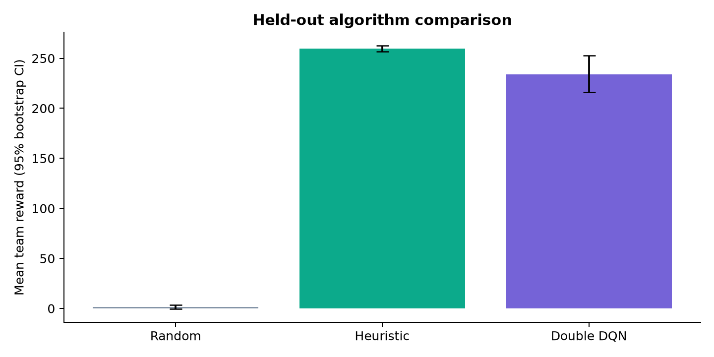
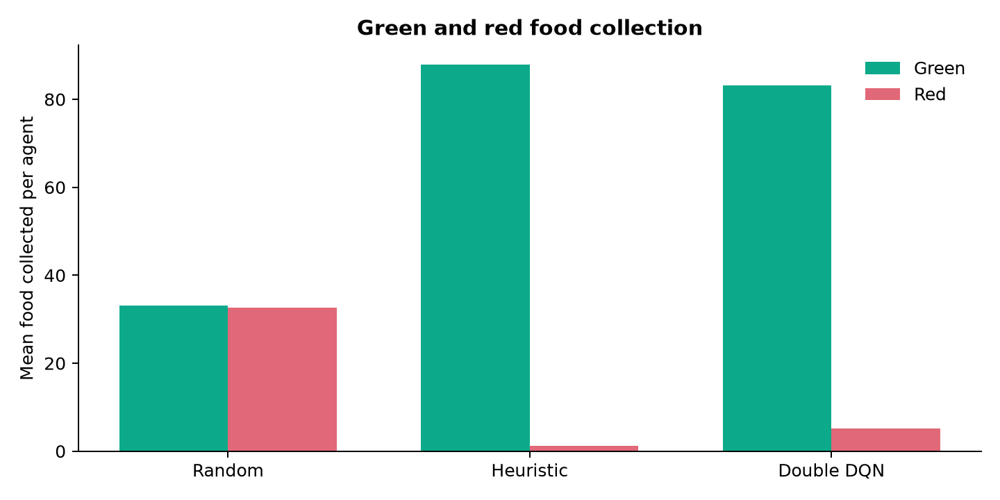
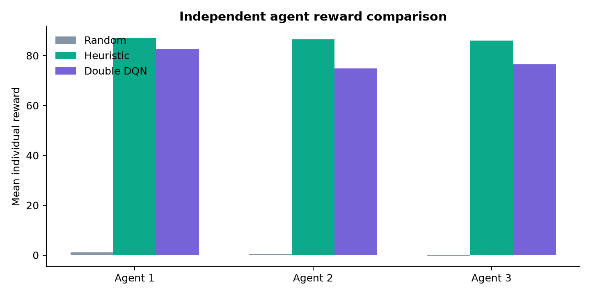
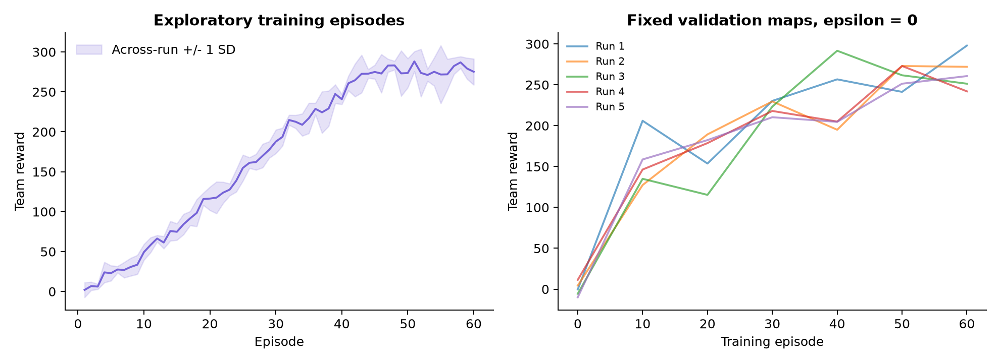
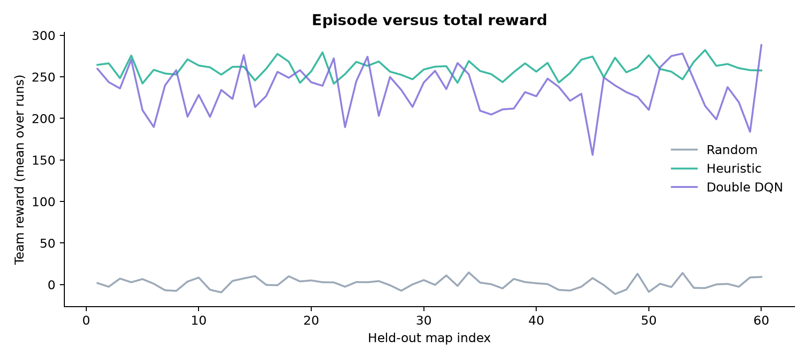
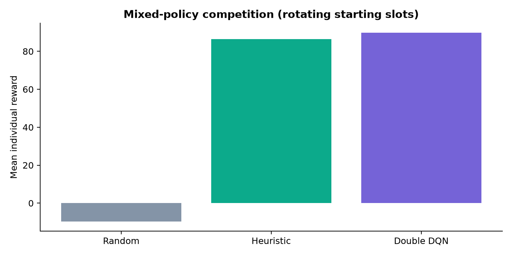

# Multi-Agent Food Foraging

BIL353 - Artificial Intelligence Term Project

Independent Double DQN, an explainable heuristic, and a random baseline

BIL353 - Artificial Intelligence Term Project

Software Engineering | Istanbul Ticaret University

| DELIVERED STUDY | RECORDED CONFIGURATION |
| --- | --- |
| Environment | 50 x 50 cells | 3 agents | 375 green + 375 red |
| Training | 5 independent repeats x 60 episodes |
| Held-out evaluation | 60 maps x 5 repeats x 4 policy conditions |
| Episode horizon | 300 decision steps in the delivered experiment |
| Reward | +1 green / -1 red / no reward shaping |

Report generated from recorded CSV and JSON results. The supplied project brief, rather than an independently supplied marking rubric, defines the requirements.

Implementation and experiment version: 17 October 2026. Submission deadline: 26 November 2026.

## 1. Abstract

This project implements a reproducible three-agent foraging environment on a 50 x 50 grid and compares random action selection, a risk-aware heuristic and independent Double Deep Q-Networks. Exactly 375 green and 375 red food cells are placed initially, and each agent receives only its own state, visible food and the location of its nearest neighbor. The original +1/-1 food rewards are preserved. 5 independent network triplets were trained for 60 episodes each; evaluation used 60 held-out maps and a 300-step finite horizon. Mean homogeneous team rewards were 1.34 for Random, 259.74 for Heuristic and 234.04 for Double DQN. Results are accompanied by run/map bootstrap intervals, raw episode logs and explicit limitations. These findings establish performance under the tested conditions, not optimality or universal superiority.

## 2. Introduction

Resource foraging provides a compact setting for studying sequential decisions, negative outcomes and competition. A useful solution must connect a precise transition model to credible experiments: visually plausible movement alone does not establish intelligent behavior or learning.

The objectives are to implement the assignment constraints, compare three decision mechanisms under matched conditions, test whether experience improves a learned policy, and deliver a readable simulation with reproducible evidence. The learning objective follows the interaction-and-reward framework of Sutton and Barto [1]. No particular grade or empirical outcome is assumed.

## 3. Problem Definition

Let the board be B in {-1,0,+1}^(50x50), with -1 red, 0 empty and +1 green. Three agents choose one action from {Up, Down, Left, Right, No Action} at each decision. A speed independently sampled from {1,2,3} determines the maximum straight-line displacement. Food is consumed at visited intermediate cells.

```text
r_i,t = green_i,t - red_i,t
R_i = sum_t r_i,t     ;     R_team = sum_i R_i
```

Each agent maximizes its own expected discounted return. Team reward is an evaluation and model-selection statistic, not a shared training reward. Because a third agent is hidden from each individual observation, the task is partially observable from an agent perspective.

## 4. Related Work

Sutton and Barto [1] formalize action values, temporal-difference learning and exploration. Tabular action-value methods provide the conceptual starting point, but enumerating arbitrary food configurations on this board is infeasible without substantial abstraction.

Mnih et al. [2] demonstrated deep Q-learning using experience replay and a target network. This project adapts those mechanisms to a small action-conditioned network with engineered vector features; it does not reproduce their visual Atari architecture or benchmark. Van Hasselt et al. [3] separate next-action selection from evaluation to reduce overestimation. This motivates the Double DQN target used here, without guaranteeing improvement in this environment.

Tan [4] distinguishes independent and cooperative multi-agent learners. The present agents have separate parameters, replay memories and rewards and do not communicate. Henderson et al. [5] discuss variation and reproducibility in deep RL, motivating multiple training repeats and uncertainty reporting.

## 5. Methodology

The implementation proceeds from a tested environment contract to baselines, learning, held-out evaluation and visualization. All policies accept an observation vector; they cannot access the Environment object. Headless training and evaluation do not depend on Pygame.

Random samples all five actions uniformly. Heuristic selects a green using distance plus a penalty when the observed neighbor is closer. It scores candidate moves using immediate green count, red risk, a reverse-Dijkstra cost-to-go to the selected target, and a small self-history oscillation term. A wait cost is part of this decision score, not an environment penalty. These scores are decision rules and never alter the environment reward. Double DQN chooses the action with the greatest learned value, except during epsilon-greedy training exploration.

```text
Dijkstra edge cost(u -> v) = 1 + 6 * red(v)
Heuristic score(a) = 3 G_path(a) - 6 C_path(a)
                     - path_length(a) - cost_to_go(endpoint(a))
                     - small oscillation / waiting terms
```

The principal comparison uses homogeneous populations (three policies of one algorithm). An additional mixed population contains one of each policy, with starting slots rotated across maps. This separates homogeneous resource collection from direct competition between unlike strategies.

An initial one-step heuristic sometimes waited at red barriers. This was diagnosed on an exploratory map set (900000..900059), and the heuristic was revised to use risk-aware path planning. That exploratory summary is archived separately. The final study below uses a fresh map set; the learned networks were not retuned using those final scores.

## 6. Environment and Agent Design

| COMPONENT | RESPONSIBILITY |
| --- | --- |
| Environment | Reset, fixed rules, episode horizon and common transition |
| MovementResolver | Synchronous substeps, bounds and food arbitration |
| Agent / Food | Individual position and counts; board food encoding |
| RewardManager | Unshaped individual +1/-1 consumption reward |
| ObservationManager | Food visibility and nearest-neighbor information filter |
| TrainingManager | Separate learners, validation and model selection |
| ExperimentEvaluator | Paired maps, raw logs and uncertainty estimation |
| SimulationRenderer | Dashboard, animation, controls and spectator view |

The 2508-element float32 observation contains 2500 food entries followed by normalized self coordinates (2), nearest-neighbor coordinates (2), own speed (1), distance-metric indicators (2), and remaining horizon (1). The food board contains no agent occupancy. Neighbor identity, speed, targets and scores are not provided.

At reset, Manhattan or Euclidean distance is chosen with equal probability and held fixed. Manhattan is |dr|+|dc| and Euclidean is sqrt(dr^2+dc^2). Ties use a seeded choice. Initial agent cells are distinct and food-free. Independent random namespaces control layouts, metrics, speeds and arbitration.

Ambiguous-rule assumptions: speed is resampled before every decision; all actions are simultaneous; movement is resolved cell by cell; borders stop movement without penalty; agents may overlap or swap; food never respawns. A green contested in the same substep goes to a Left mover if available. Any remaining tie, or a red contest, uses seeded random arbitration. Earlier arrival beats later arrival. Food is consumed exactly once. All food depleted or the finite horizon ends the episode. These assumptions require comparison with any later instructor clarification; they are not attributed to the brief.

The delivered verification record contains 54 automated tests. Tests cover geometry, density, reward accounting, all actions, bounds, simultaneous competition, hidden-agent invariance, speed support, repeatability, conservation, learning updates, saved-model equivalence and renderer controls. Test success is evidence for tested scenarios, not a proof that every possible defect is absent.

## 7. Reinforcement Learning Algorithm

Each learner evaluates Q_theta(o,a) = MLP_theta(phi(o,a)). The visible-information encoder produces 22 features for each of the five candidate actions. Six indicators describe green/red presence in each of three path cells. Other features describe the nearest remaining green relative to the endpoint, observed-neighbor geometry, movement length, own speed, metric, action identity, remaining green fraction and remaining time. The neighbor-to-target advantage feature uses Manhattan geometry as an approximation even when neighbor selection uses Euclidean distance.

The network is 22-32-1 with tanh hidden activations (769 parameters per agent). A single network scores all action descriptions. It receives no demonstration actions, no heuristic override and no shaped reward. Feature engineering provides a strong inductive bias and loses some full-map information; the method is not end-to-end learning from raw pixels.

```text
a* = argmax_b Q_online(o_next, b)
y = r + gamma (1 - done) Q_target(o_next, a*)
error = Q_online(o, a) - y
Huber(error) = 0.5 error^2        if |error| <= 1
               |error| - 0.5     otherwise
```

A replay minibatch minimizes Huber loss with Adam. Gradients are globally clipped at norm 10. Every 200 gradient updates the target weights are copied from the online network. At the finite task horizon done=1; the learner does not bootstrap beyond the episode budget. Remaining time is observable. Partial observability and co-learning opponents prevent a general convergence or optimality claim.

| HYPERPARAMETER | VALUE |
| --- | --- |
| Discount / learning rate | 0.90 / 0.001 |
| Replay / warm-up / batch | 20000 per agent / 256 transitions / 64 |
| Update frequency / target sync | Every 4 transitions / 200 gradient updates |
| Optimizer / loss | Adam (0.9, 0.999, epsilon=1e-8) / Huber delta=1 |
| Exploration | epsilon=max(0.05, 1-0.95*episode/(0.8*episodes)) |
| Inference / checkpoints | epsilon=0; NPZ weights and encoder version |

NPZ models are inference checkpoints. Optimizer, replay and generator states are not saved for exact mid-training resumption. last_agent files preserve final weights separately from validation-selected weights.

## 8. Experimental Setup

The delivered experiment used 5 independent training repeats, each with three simultaneously learning agents for 60 episodes of up to 300 decisions. Every ten episodes and at episode zero, greedy validation ran on three fixed maps. The best validation team score selected a network triplet within each run. No final-test scores were used to select checkpoints.

| ITEM | RECORDED SETTING |
| --- | --- |
| Training maps | 10000 + 100000*run + zero-based episode index |
| Validation maps | 500000..500002 (three fixed maps, reused) |
| Final test maps | 950000..950059 |
| Conditions | Homogeneous Random, Heuristic, RL; one-of-each mixed |
| Evaluation budget | 1200 episodes; 3600 agent records |
| Food / metric / speed | 375+375; equal metric probability; uniform speed 1..3 |
| Primary outcome | Mean homogeneous team episode reward |
| Uncertainty | 2000 crossed run/map bootstrap resamples, percentile 95% CI |

Policies use independent random generators. Layout and per-step speeds are keyed independently of policy randomness, so algorithms share the same exogenous scenario for a given map. Food ties use event-keyed randomness; different behavior can still create different contests. The mixed condition rotates the three policy types across slots in a three-map cycle.

Individual reward, green/red counts, green collection fraction, steps and reward per step are logged. Team green fraction is total green divided by 375. Overlap counts are pair-substep occupancy events, including stationary overlap; swaps are pair-substep exchanges; competitions are food-cell contests. These environment events appear identically on the three agent rows and must not be summed across those rows.

For uncertainty, the reward matrix has independent run and paired-map axes; both axes are resampled. Agents are aggregated before inference. Paired RL-minus-baseline intervals use differences on the same run/map coordinates. Only five runs limit precision. Evaluation is on new maps from the same generator distribution, not an out-of-distribution generalization test.

Execution uses Python 3.13.1 with NumPy and CPU computation. The exact environment versions are recorded in requirements-lock.txt and runtime.json. Interactive default horizon is 500, whereas the recorded models and experiments use 300; their results must not be conflated.

## 9. Results and Evaluation

| ALGORITHM | TEAM MEAN | TEAM SD | 95% CI |
| --- | --- | --- | --- |
| Random | 1.34 | 11.55 | [-0.52, 3.34] |
| Heuristic | 259.74 | 14.77 | [256.84, 262.67] |
| Double DQN | 234.04 | 58.26 | [216.31, 252.96] |

The paired mean Double-DQN-minus-Random team reward difference was 232.70, with 95% bootstrap interval [215.40, 251.45]. This comparison applies to the fixed tested budget.

The paired mean Double-DQN-minus-Heuristic team reward difference was -25.70, with 95% bootstrap interval [-42.97, -6.89]. This comparison applies to the fixed tested budget.



Figure 1. Homogeneous held-out team reward. Error bars are crossed-bootstrap 95% intervals.

Team SD describes the spread of run/map episode outcomes, while the CI describes uncertainty in the estimated mean. These are different quantities. The experiment does not establish performance on a different food density or on a longer episode horizon.

## Results: food and individual agents



Figure 2. Mean green and red food consumed per individual agent.



Figure 3. Mean reward by starting agent slot in homogeneous populations.

| POLICY | GREEN/AGENT | RED/AGENT | TEAM GREEN % | REWARD/STEP |
| --- | --- | --- | --- | --- |
| random | 33.16 | 32.71 | 26.5% | 0.0015 |
| heuristic | 87.86 | 1.28 | 70.3% | 0.2886 |
| rl | 83.20 | 5.18 | 66.6% | 0.2600 |

## Results: learning and unseen maps



Figure 4. Training reward with +/-1 SD band, and greedy validation by independent run.



Figure 5. Team reward on each held-out map, averaged over independent runs.

| RUN | UNTRAINED VALIDATION | SELECTED EPISODE | SELECTED VALIDATION |
| --- | --- | --- | --- |
| run_0 | -0.33 | 60 | 298.00 |
| run_1 | 4.33 | 50 | 273.00 |
| run_2 | -5.67 | 40 | 291.67 |
| run_3 | 11.33 | 50 | 273.00 |
| run_4 | -10.00 | 60 | 260.67 |

## Results: mixed competition and interactions



Figure 6. Individual reward when one of each policy shares the same environment.

| MIXED POLICY | REWARD | GREEN | RED |
| --- | --- | --- | --- |
| random | -9.71 | 27.20 | 36.91 |
| heuristic | 86.38 | 87.72 | 1.34 |
| rl | 89.82 | 95.55 | 5.73 |

| MODE | CONTESTS | LEFT WINS | OVERLAPS | STEPS |
| --- | --- | --- | --- | --- |
| random | 0.017 | 0.003 | 1.13 | 300.0 |
| heuristic | 0.477 | 0.140 | 4.67 | 300.0 |
| rl | 0.143 | 0.057 | 7.84 | 300.0 |

Interaction counts above are per environment episode, not per agent. Naturally occurring food contests may be rare in sparse spatial encounters; controlled tests therefore provide the direct evidence that Left priority is implemented. Mixed-policy results describe a different opponent population from the homogeneous training population.

## 10. Discussion

Double DQN achieved a lower homogeneous mean team reward than the heuristic in this experiment (234.04 versus 259.74). The paired interval above, rather than the means alone, should guide interpretation of that difference. Validation trajectories show learning variation and occasional regression, which is why checkpoint selection is separated from final testing.

The heuristic is competitive because food is fully visible and short straight paths can be evaluated directly. RL benefits from a feature encoder that describes those same observable path opportunities. Its performance is therefore evidence about learning an action-value mapping under engineered features, not evidence that a network independently discovered every useful spatial abstraction. The separate Random baseline helps expose the value of exploiting visible structure.

## 11. Limitations

The study uses five training repeats, three repeatedly reused validation maps, one food density and a 300-step evaluation horizon. Hyperparameters were fixed without an extensive search. New maps share the training generator; robustness to changed layouts, respawn, blocking collisions or alternate speed timing is unmeasured. Partial observations and a lossy feature encoder create state aliasing, and independent co-learning can be nonstationary.

The aggregate heuristic-to-RL comparison does not isolate Double DQN versus ordinary DQN, or the effect of each feature; such ablations remain future experiments. Model files do not preserve complete training state. GUI tests exercise headless rendering and controls, not every desktop configuration. Ambiguous assignment rules are documented assumptions and should be checked against instructor clarification before submission.

## 12. Conclusion

The project delivers a tested multi-agent environment, three runnable policy families, independent learned models, a Pygame dashboard, matched held-out experiments and a report tied to raw data. Its contribution is an inspectable connection between assignment rules, algorithm behavior and empirical evidence. Further work should expand validation maps, training repeats and feature/algorithm ablations before claiming broader superiority.

## 13. References

[1] Sutton, R. S., & Barto, A. G. (2018). Reinforcement Learning: An Introduction (2nd ed.). MIT Press.

https://mitpress.ublish.com/book/reinforcement-learning-an-introduction-2

[2] Mnih, V., et al. (2015). Human-level control through deep reinforcement learning. Nature, 518, 529-533. doi:10.1038/nature14236.

https://www.nature.com/articles/nature14236

[3] van Hasselt, H., Guez, A., & Silver, D. (2015). Deep Reinforcement Learning with Double Q-learning. arXiv:1509.06461; subsequently AAAI 2016.

https://arxiv.org/abs/1509.06461

[4] Tan, M. (1993). Multi-Agent Reinforcement Learning: Independent Versus Cooperative Agents. ICML, 330-337. doi:10.1016/B978-1-55860-307-3.50049-6.

https://mlanthology.org/icml/1993/tan1993icml-multi/

[5] Henderson, P., Islam, R., Bachman, P., Pineau, J., Precup, D., & Meger, D. (2017). Deep Reinforcement Learning that Matters. arXiv:1709.06560; subsequently AAAI 2018.

https://arxiv.org/abs/1709.06560

Reproduction: README.md documents installation, test, training, evaluation and report commands. docs/ASSUMPTIONS.md is the transition contract. results/episodes.csv contains the full evaluation records; results/summary.json contains aggregates and intervals; models/run_*/training.csv contains learning histories. requirements-lock.txt records exact package versions. MANIFEST.json provides SHA256 integrity checks.

The supplied brief is a project requirement source, not a scientific publication. No external paper is used to imply that the measured project results reproduce the paper benchmarks.
