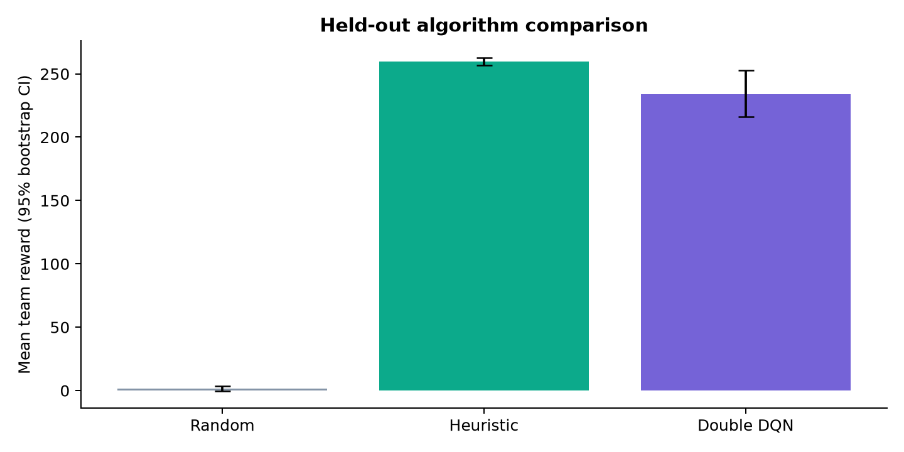
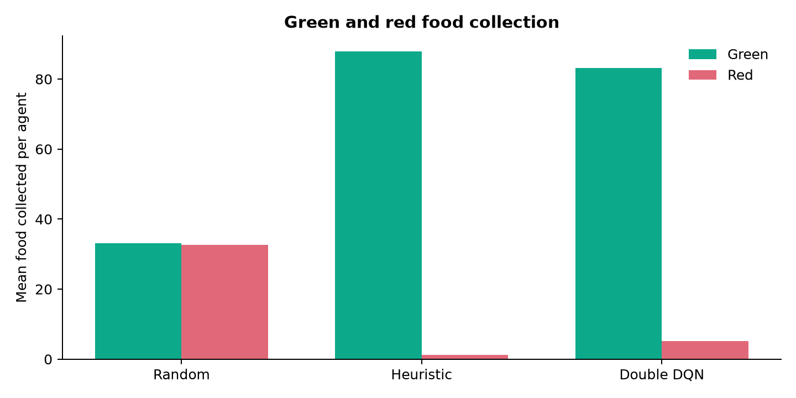
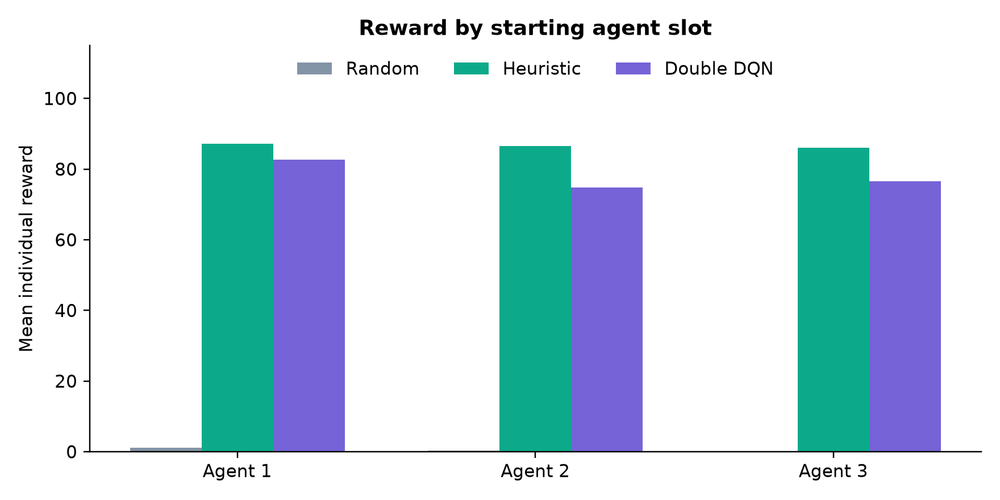
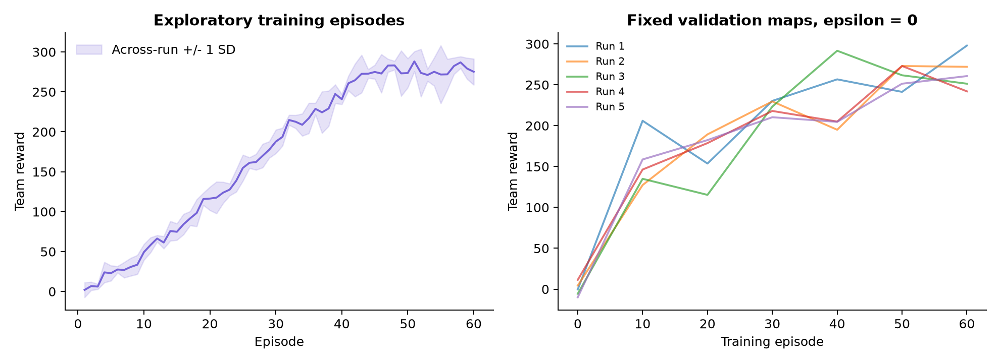
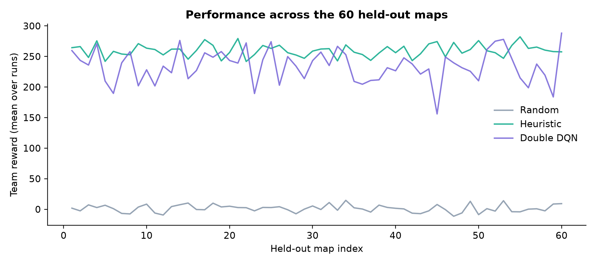
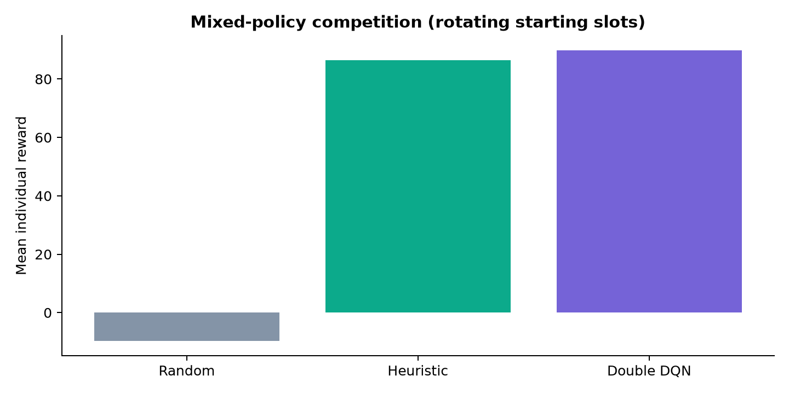

# Multi-Agent Food Foraging

BIL353 - Artificial Intelligence Term Project

Istanbul Ticaret University

Software Engineering

BIL353 - Artificial Intelligence Term Project

A comparison of Random, Heuristic and Independent Double DQN agents

| EXPERIMENT | SETTING |
| --- | --- |
| Board and agents | 50 x 50 grid; three independent agents |
| Initial food | 375 green and 375 red cells |
| Training | 5 runs, each with 60 episodes |
| Evaluation | 60 test maps; four policy conditions; 5 repeats |
| Episode length | Up to 300 decision steps |
| Food reward | +1 for green; -1 for red |

This report describes the implementation and the experiment recorded in the project files. The results below use the saved models, training logs and evaluation data.

## 1. Abstract

In this project, we compare three ways of controlling agents in a food-foraging game: random actions, a hand-written heuristic and independent Double DQN. Three agents move on a 50 x 50 grid, collecting green food for a positive reward and receiving a penalty for red food. Each agent can see the food map, its own state and the position of its nearest neighbor. We trained 5 sets of three RL agents for 60 episodes per set, then evaluated the methods on 60 new maps with a 300-step limit. When all three agents used the same method, the average team rewards were 1.34 for Random, 259.74 for Heuristic and 234.04 for Double DQN. The learned agents performed much better than Random, but the heuristic collected food more reliably in this experiment.

## 2. Introduction

The aim of the project is to study how different decision methods behave in the same environment. The rules are simple, but an agent still has to decide whether to approach nearby food, avoid a red cell or move toward an area that another agent may reach first.

We use Random as a basic comparison, Heuristic as a rule-based solution and Double DQN as a method that learns from rewards. Following the reinforcement learning framework in Sutton and Barto [1], an RL agent improves its action values through experience. The main question here is how well that approach works against a practical heuristic within a small training budget.

## 3. Problem Definition

The board contains 2,500 cells. At the start, 375 cells contain green food and 375 contain red food, so each color occupies 15% of the board. Each agent chooses Up, Down, Left, Right or No Action. Its speed is sampled uniformly from 1, 2 or 3 before each decision. A move follows a straight path and can collect food from intermediate cells as well as the endpoint.

```text
r_i,t = green collected by agent i - red collected by agent i
R_i = sum_t r_i,t          R_team = R_0 + R_1 + R_2
```

The agents receive their own rewards. We add their episode scores to compare team performance and select model checkpoints. An agent cannot observe the other two agents in full, so its observation does not describe the complete game state.

## 4. Related Work

Sutton and Barto [1] explain action values, exploration and learning from rewards. These ideas provide the starting point for our RL agent. A direct table of all possible food-map states would be too large, so we approximate action values with a small neural network.

Mnih et al. [2] combine a neural network with experience replay and a target network in DQN. We use these two training mechanisms, but our input is a set of numerical features rather than game images. Double DQN [3] uses the online network to select the next action and the target network to evaluate it. This separation is intended to reduce overestimated action values.

Tan [4] compares independent learning with approaches that share information between agents. Our agents learn separately and do not exchange rewards or replay data. Henderson et al. [5] discuss how random seeds and experimental choices affect RL results. We therefore report several training runs and confidence intervals.

## 5. Methodology

All three methods receive the same observation format. Random chooses each of the five actions with equal probability. Double DQN scores the five actions using its learned network; during training it also explores with random actions.

Heuristic selects a green target using its distance plus a penalty of 1.5 when the visible neighbor is judged closer. It keeps that target until the food disappears. The agent-to-target distance uses the episode metric, while the neighbor-to-target distance always uses Manhattan distance. This is an approximation when the episode metric is Euclidean.

A reverse Dijkstra search estimates the cost of reaching the target. Entering a red cell costs more than entering an empty or green cell. The action score also considers food on the immediate path and discourages waiting or returning to the previous position.

```text
edge_cost(u -> v) = 1 + 6 * I(v contains red food)
score(a) = 3 * green_on_path - 6 * red_on_path
           - path_length - cost_to_target(endpoint)
           - repeat_penalty - stationary_penalty
```

The repeat penalty is 0.05; the stationary penalty is 0.4 for No Action or 0.6 for a move that cannot leave the cell. These scores only guide decisions. The actual food rewards remain +1 and -1. The earlier heuristic had difficulty with red barriers; the separate exploratory results use seeds 900000-900059. The final comparison uses new test seeds after the path-planning revision.

## 6. Environment and Agent Design

| COMPONENT | ROLE |
| --- | --- |
| Environment | Creates maps, supplies observations and advances each decision step |
| MovementResolver | Moves agents in substeps and resolves simultaneous food claims |
| Agent / Food | Stores agent state and represents food on the board |
| RewardManager | Updates food counts and individual rewards |
| ObservationManager | Builds the permitted observation for each agent |
| TrainingManager | Trains separate agents and selects checkpoints by validation |
| ExperimentEvaluator | Runs comparisons and saves per-agent records |
| SimulationRenderer | Displays the board, scores and interactive controls |

Each observation has 2,508 float32 values: 2,500 food cells, two coordinates for the agent, two for the nearest neighbor, the current speed, two distance-metric indicators and the fraction of time remaining. All food is visible. The other agents are absent from the board encoding; neighbor speed, identity, target and score are not included.

At reset, the environment chooses Manhattan or Euclidean distance with equal probability and uses it for the whole episode. Equal-distance neighbor ties use a seeded random choice. The agents start in distinct cells without food. Separate seeded random generators handle maps, distance metrics, speeds and food contests.

Actions are simultaneous, but movement is resolved one cell at a time. Borders stop movement without a reward penalty, and agents can overlap or swap places. If several agents claim green food in the same substep, a Left action has priority. Remaining ties and red-food contests use seeded randomness. Earlier arrival wins over later arrival, and each food item is consumed once.

Food does not respawn. An episode ends when all food is gone or the time limit is reached. These choices, including speed timing and overlap behavior, are listed in docs/ASSUMPTIONS.md as implementation assumptions.

The saved test record contains 54 tests and 0 failures or errors. It covers movement, reward accounting, food conservation, information hiding, model loading, learning updates and renderer controls. This is the recorded verification run supplied with the experiment.

## 7. Reinforcement Learning Algorithm

Each RL agent owns a network, a target network and a replay buffer. The network takes 22 features for one candidate action and outputs its estimated value. It has 32 tanh hidden units and one output: 22 x 32 + 32 + 32 + 1 = 769 trainable parameters per agent. The same network is applied to all five actions.

Six features indicate green or red food on up to three path cells. The remaining features describe the closest currently visible green from the proposed endpoint, neighbor geometry, movement length, speed, metric, action identity, green-food fraction and remaining time. The encoder uses the current board: it does not first remove food that the proposed move would consume. Its neighbor-to-target comparison uses Manhattan distance even in Euclidean episodes.

These features give the learner useful spatial information, but they compress the full observation. No demonstration actions or heuristic overrides are used. The training target follows Double DQN [3]:

```text
a* = argmax_b Q_online(o_next, b)
y = r + gamma * (1 - done) * Q_target(o_next, a*)
e = Q_online(o, a) - y
Huber(e) = 0.5 * e^2       if |e| <= 1
           |e| - 0.5      otherwise
```

| SETTING | VALUE |
| --- | --- |
| Discount / learning rate | 0.90 / 0.001 |
| Replay capacity / warm-up / batch | 20,000 per agent / 256 transitions / 64 |
| Update / target copy | Every 4 transitions / every 200 gradient updates |
| Optimizer / gradient clipping | Adam (0.9, 0.999, epsilon=1e-8) / global norm 10 |
| Exploration schedule | epsilon = max(0.05, 1 - 0.95 * episode / (0.8 * E)) |
| Recorded E / evaluation epsilon | 60 training episodes / 0 |

Here episode is one-based for training. With E=60, epsilon starts at about 0.9802 and reaches 0.05 at episode 48. The episode-zero row records validation before training. At the time limit, done=1 and the target contains no future reward beyond the episode. Saved NPZ files contain inference weights and metadata; they do not store the optimizer or replay state needed to resume training exactly.

## 8. Experimental Setup

We trained 5 independent sets of three agents. Each run used 60 episodes with at most 300 decisions per episode. Before training and every ten episodes, the agents were evaluated without exploration on three fixed validation maps. The highest validation team reward selected a set of three checkpoints for each run.

| ITEM | SETTING |
| --- | --- |
| Training seeds | 10000 + 100000 * run + zero-based episode index |
| Validation seeds | 500000-500002; reused for checkpoint selection |
| Final test seeds | 950000-950059; separate from training and validation |
| Same-method teams | Three Random, three Heuristic or three Double DQN agents |
| Mixed team | One agent per method; starting slots rotate every map |
| Evaluation size | 4 conditions x 5 repeats x 60 maps = 1,200 episodes |
| Evaluation records | 3 agent records per episode = 3,600 rows |
| Confidence intervals | 2,000 bootstrap resamples of both run and map axes |

The five repeats correspond to independently trained networks for RL and different policy random seeds for the baselines. Every condition uses the same 60 test maps. Map layout, distance metric and the speed sequence for each starting slot are fixed by the map seed. Policy decisions can still produce different food contests. In mixed teams, the RL model is the checkpoint associated with the slot occupied by the RL agent.

The main outcome is team reward in the same-method teams. We first add the three agent scores for each episode, then form a 5 x 60 matrix. Confidence intervals resample runs and maps separately and take the 2.5th and 97.5th percentiles of the resulting means. Comparisons use RL-minus-baseline differences at matching run and map positions. The three agents in one episode are not treated as independent samples.

Food counts and reward per step are also reported per agent. Team green collection is the total green count divided by 375. Contests and overlaps are environment events copied into each agent row, so they are counted once per episode. An overlap is counted for each pair at each substep, including stationary overlap.

The saved runtime record specifies Python 3.13.1 and NumPy on CPU. Package versions are in requirements-lock.txt. The interface defaults to 500 steps, while this experiment uses 300. New test maps come from the same map generator as training, so this evaluation measures performance on new seeds under the same rules.

## 9. Results and Evaluation

9.1 Same-method teams

| METHOD | TEAM MEAN | TEAM SD | 95% CI OF MEAN |
| --- | --- | --- | --- |
| Random | 1.34 | 11.55 | [-0.52, 3.34] |
| Heuristic | 259.74 | 14.77 | [256.84, 262.67] |
| Double DQN | 234.04 | 58.26 | [216.31, 252.96] |

Heuristic has the highest mean team score. Double DQN also earns a strong positive score, but its results vary more across runs and maps. Random is close to zero because its green gains and red penalties largely cancel out.



Figure 1. Mean team reward across 300 episodes per method (5 repeats x 60 maps). Error bars show 95% bootstrap intervals.

The paired Double DQN minus Random difference is 232.70 team reward, with a 95% interval of [215.40, 251.45].

The paired Double DQN minus Heuristic difference is -25.70 team reward, with a 95% interval of [-42.97, -6.89].

The RL-minus-Heuristic interval lies below zero, supporting the heuristic advantage at this training and test budget. SD describes variation between episode outcomes; the confidence interval describes uncertainty in the mean.

## 9.2 Food Collection and Individual Agents



Figure 2. Average green and red food collected by one agent per episode.



Figure 3. Average reward by starting slot in same-method teams. Agent 1-3 in the figure correspond to code slots 0-2.

| METHOD | GREEN / AGENT | RED / AGENT | TEAM GREEN % | REWARD / AGENT / STEP |
| --- | --- | --- | --- | --- |
| Random | 33.16 | 32.71 | 26.5% | 0.0015 |
| Heuristic | 87.86 | 1.28 | 70.3% | 0.2886 |
| Double DQN | 83.20 | 5.18 | 66.6% | 0.2600 |

Heuristic collects slightly more green food than Double DQN while consuming fewer red cells. Both differences contribute to its higher score. The food counts and reward-per-step column refer to one agent; the green percentage refers to all three agents together.

## 9.3 Learning Progress and New Maps



Figure 4. Training reward and greedy validation scores. The shaded training band shows one SD across five runs. Plot Run 1-5 correspond to run_0-run_4.

| RUN | INITIAL VALIDATION | SELECTED EPISODE | SELECTED VALIDATION |
| --- | --- | --- | --- |
| run_0 | -0.33 | 60 | 298.00 |
| run_1 | 4.33 | 50 | 273.00 |
| run_2 | -5.67 | 40 | 291.67 |
| run_3 | 11.33 | 50 | 273.00 |
| run_4 | -10.00 | 60 | 260.67 |

All five selected models score above their untrained validation baselines. The best checkpoint is sometimes earlier than episode 60, which shows that more training did not improve every run steadily. These are scores on the three reused validation maps, rather than final-test results.



Figure 5. Team reward on each of the 60 test maps, averaged over five repeats. The horizontal axis indexes test maps, not training progress.

## 9.4 Mixed Teams and Agent Interactions



Figure 6. Mean individual reward in mixed teams, with 300 episodes per policy and starting slots rotated across maps.

| POLICY | REWARD / AGENT | GREEN / AGENT | RED / AGENT |
| --- | --- | --- | --- |
| Random | -9.71 | 27.20 | 36.91 |
| Heuristic | 86.38 | 87.72 | 1.34 |
| Double DQN | 89.82 | 95.55 | 5.73 |

Double DQN has a slightly higher descriptive mean than Heuristic in mixed teams (89.82 versus 86.38). This table does not include a paired uncertainty estimate, so the small gap alone is not enough to establish an advantage. Mixed teams also expose RL to different opponents from those used in training.

| SAME-METHOD TEAM | CONTESTS | LEFT-PRIORITY EVENTS | OVERLAPS | STEPS |
| --- | --- | --- | --- | --- |
| Random | 0.017 | 0.003 | 1.13 | 300 |
| Heuristic | 0.477 | 0.140 | 4.67 | 300 |
| Double DQN | 0.143 | 0.057 | 7.84 | 300 |

The interaction table returns to same-method teams. Values are means per environment episode. A Left-priority event is a contested green cell where at least one contender chose Left. It is not a win rate. Such contests are rare in the recorded maps; controlled movement tests check the priority rule directly.

## 10. Discussion

The clearest result is that Double DQN learns useful behavior, but the heuristic performs better in the main comparison. Heuristic earns 259.74 team reward on average, compared with 234.04 for Double DQN. Its lower red food count and smaller spread in episode scores help explain this difference.

A likely reason is that the full food map is visible. The heuristic can plan a route to a specific target and account for red cells along that route. The RL agent instead learns from a compact description of each possible move. It has useful local information, but the feature vector does not retain every detail of the map. This is an interpretation of the design and results; separate feature-removal experiments would be needed to test it.

The mixed-team ranking also shows why the evaluation setting matters. A method that collects the most food in a team of similar agents may behave differently when competing with other strategies. The homogeneous team scores and mixed individual scores should therefore be read separately.

## 11. Limitations

The experiment uses five training runs, only three validation maps, one food density and a 300-step horizon. Reusing a small validation set can favor checkpoints that suit those maps. The final test set is separate, but it comes from the same generator, so it does not test changed rules or unfamiliar map types.

We did not compare Double DQN with ordinary DQN or remove features one at a time. The results therefore cannot isolate the benefit of the Double DQN target or any particular feature. The agents also observe only one neighbor, and their learning opponents change during training. These factors make learning less stable. Longer training, more validation maps and additional random seeds would give a fuller picture.

Saved models support inference but not exact mid-training resumption. The interface has a different default horizon, and renderer tests do not cover every desktop setup. The rule assumptions should also be checked against the instructor's final requirements.

## 12. Conclusion

The project brings together a working multi-agent environment, three decision methods and a visual interface. Double DQN improves substantially over Random, while the path-based heuristic remains the stronger method for same-method teams in this experiment. A useful next step is to expand validation and training, then compare ordinary DQN and simpler feature sets under the same test conditions.

## 13. References

[1] Sutton, R. S., & Barto, A. G. (2018). Reinforcement Learning: An Introduction (2nd ed.). MIT Press.

https://mitpress.mit.edu/9780262039246/reinforcement-learning/

[2] Mnih, V., et al. (2015). Human-level control through deep reinforcement learning. Nature, 518, 529-533. doi:10.1038/nature14236.

https://www.nature.com/articles/nature14236

[3] van Hasselt, H., Guez, A., & Silver, D. (2015). Deep Reinforcement Learning with Double Q-learning. arXiv:1509.06461; subsequently AAAI 2016.

https://arxiv.org/abs/1509.06461

[4] Tan, M. (1993). Multi-Agent Reinforcement Learning: Independent Versus Cooperative Agents. ICML, 330-337. doi:10.1016/B978-1-55860-307-3.50049-6.

https://mlanthology.org/icml/1993/tan1993icml-multi/

[5] Henderson, P., Islam, R., Bachman, P., Pineau, J., Precup, D., & Meger, D. (2017). Deep Reinforcement Learning that Matters. arXiv:1709.06560; subsequently AAAI 2018.

https://arxiv.org/abs/1709.06560

Project files used for the results

The numerical results come from results/episodes.csv and results/summary.json. Training progress and selected checkpoints are recorded in models/run_*/training.csv and selection.json. The rule assumptions are in docs/ASSUMPTIONS.md, and the saved automated-test record is results/test_results.xml.

README.md gives installation, training and evaluation commands. This revised report can be rebuilt from the project directory with the command below. It checks the saved statistics and does not start a new training run.

```text
python -m report.build_reviewed_report
```
